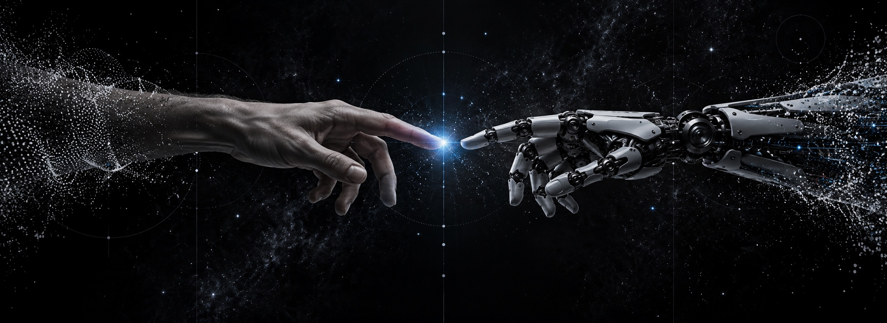

  

<h1 align="center">Pedro Llonch</h1>

  <b>AI builder &amp; creative technologist</b> · Founder of <a href="https://bragistudio.co">Bragi Studio</a> · New York

  <a href="https://pedrollonch.com">pedrollonch.com</a> &nbsp;·&nbsp;
  <a href="https://bragistudio.co">bragistudio.co</a> &nbsp;·&nbsp;
  <a href="https://linkedin.com/in/pedrollonch">LinkedIn</a>

---

### About

I build working software, automation systems and visual campaigns with AI.
Most of my code is written alongside coding agents (Claude Code, Codex, and open-weight models)
that I direct, review and ship. I studied Economics at SUNY Purchase (2026) and run
Bragi, a design and technology studio for founders and small businesses.

### Live work

| | |
|---|---|
| **[Spine](https://pedrollonch.com/spine/)** | Desktop app that turns an iMessage archive into follow-ups. MVP built at the Claude Fable 5.1 build night in Electron, React and TypeScript; messages never leave the Mac. The live demo runs on a synthetic archive. |
| **[Generative AI campaigns](https://pedrollonch.com)** | Three spec campaigns made without a shoot or crew: a [luxury resort](https://pedrollonch.com/work/habitas), an [architectural film](https://pedrollonch.com/work/llv) and an [eight-room interior series](https://pedrollonch.com/work/sas). |
| **[Bragi Studio](https://bragistudio.co)** | Brand identity, websites coded from scratch, and AI-generated campaign visuals. |

### Building now

**Pedro Growth OS** is a private content operation for two brands. It researches, scripts, renders and
publishes posts on scheduled jobs, controlled from Notion and Telegram, with automatic failover between
models. Every post is approved by a human before it goes out.

### Tools

`Claude Code` `Codex` `OpenCode` `Cursor` `TypeScript` `React` `Electron` `Python` `Vercel`
 
`Nano Banana Pro` `Kling` `Magnific` `Topaz Video`

---

Project repositories are being cleaned up and will be published here soon.

