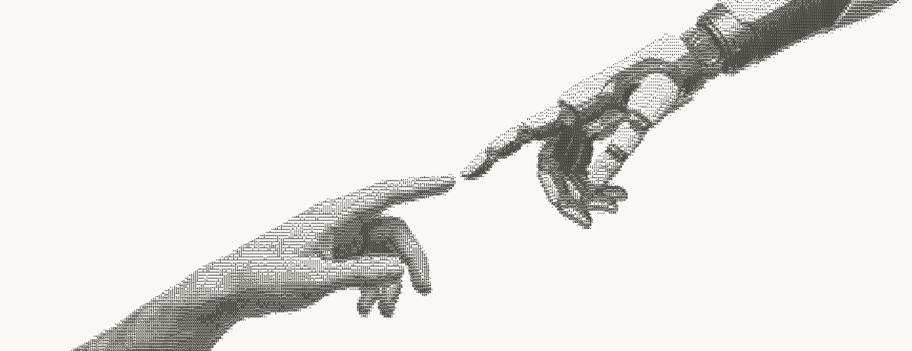

  

<h1 align="center">Pedro Llonch</h1>

  <b>AI builder &amp; creative technologist</b> · Founder of <a href="https://bragistudio.co">Bragi Studio</a> · New York

  <a href="https://pedroai.dev">pedroai.dev</a> &nbsp;·&nbsp;
  <a href="https://bragistudio.co">bragistudio.co</a> &nbsp;·&nbsp;
  <a href="https://linkedin.com/in/pedrollonch">LinkedIn</a>

---

### About

I graduated with a BA in Economics in 2026 and run Bragi, a design and
technology studio building brands, websites and AI-powered campaigns.
Outside Bragi, I build software and AI tools of my own. I work with coding
agents, then review, refine and ship the results myself.

### Live work

| Project | What it is |
|---|---|
| **[Spine](https://pedrollonch.com/spine/)** | Desktop app that turns an iMessage archive into follow-ups. MVP built at the Claude Fable 5.1 build night in Electron, React and TypeScript; messages never leave the Mac. The live demo runs on a synthetic archive. |
| **[Generative AI campaigns](https://pedrollonch.com)** | Three spec campaigns made without a shoot or crew: a [luxury resort](https://pedrollonch.com/work/habitas), an [architectural film](https://pedrollonch.com/work/llv) and an [eight-room interior series](https://pedrollonch.com/work/sas). |
| **[Bragi Studio](https://bragistudio.co)** | Brand identity, websites coded from scratch, and AI-generated campaign visuals. |

### Tools

`Claude Code` `Codex` `OpenCode` `Cursor` `TypeScript` `React` `Electron` `Python` `Vercel`
 
`Nano Banana Pro` `Kling` `Magnific` `Topaz Video`

---

Project repositories are being cleaned up and will be published here soon.

